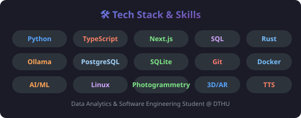

# Hi, I'm Doan Minh Tri 👋

**IT Student | Data & Software Enthusiast | AI Automation Learner**

Mình là sinh viên Công nghệ Thông tin tại Việt Nam, tập trung học tập và xây dựng các dự án thực tế về:

- Python, TypeScript, C#/.NET, C và web development
- Xử lý dữ liệu, computer vision và làm sạch dataset
- AI tooling, automation và tối ưu workflow
- Việt hóa phần mềm/game và phát triển các công cụ hỗ trợ cộng đồng

## 📌 Current focus

- Xây dựng `vision-cleanse`: công cụ phát hiện near-duplicate và train/validation/test leakage trong dataset computer vision.
- Phát triển workflow tự động hóa bằng Python và các công cụ AI.
- Tiếp tục thực hành web app, IoT, C#/.NET và các dự án học tập phần mềm.

## 🚀 Recently updated repositories

Danh sách dưới đây được cập nhật theo hoạt động GitHub mới nhất (03/11/2026):

| Repository | Nội dung | Ngôn ngữ | Cập nhật gần nhất |
|---|---|---:|---:|
| [vision-cleanse](https://github.com/MinhTriTM/vision-cleanse) | Làm sạch near-duplicate và leakage trong dataset computer vision | Python | 03/11/2026 |
| [valheim-vietnamese-community](https://github.com/MinhTriTM/valheim-vietnamese-community) | Việt hóa Valheim và hơn 18 mods, kèm triển khai BepInEx tự động | Python | 22/09/2026 |
| [-CNKT-EVENT-HUB](https://github.com/MinhTriTM/-CNKT-EVENT-HUB) | Nền tảng sự kiện | TypeScript | 10/09/2026 |
| [KeHoachHocTap](https://github.com/MinhTriTM/KeHoachHocTap) | Công cụ/kế hoạch học tập | CSS | 04/09/2026 |
| [ai-crypto-trading-lab](https://github.com/MinhTriTM/ai-crypto-trading-lab) | Phòng thí nghiệm giao dịch crypto có hỗ trợ AI | Python | 29/08/2026 |

## 🛠️ Tech snapshot

**Languages & platforms:** Python · TypeScript · C#/.NET · C · HTML · CSS · PowerShell · SQL
**Interests:** Data processing · Computer vision · AI automation · Web apps · IoT · Localization

## 📈 GitHub activity

- [Xem toàn bộ repository](https://github.com/MinhTriTM?tab=repositories)
- [Xem hoạt động gần đây](https://github.com/MinhTriTM?tab=overview)

## 🎮 Mini game

Bấm vào banner để chơi **Rắn săn mồi** ngay trên trình duyệt — phím mũi tên/WASD trên máy tính, vuốt hoặc nút bấm trên điện thoại. Điểm cao nhất lưu trên trình duyệt của bạn.

## 📊 Profile snapshot

| Thông tin | Giá trị |
|---|---:|
| Public repositories | 36 |
| Followers | 2 |
| Following | 3 |
| Vị trí | Việt Nam |

> Số liệu hồ sơ và danh sách dự án được rà soát lần cuối vào **03/11/2026**.

## 📄 License

This repository is licensed under the [MIT License](LICENSE).
